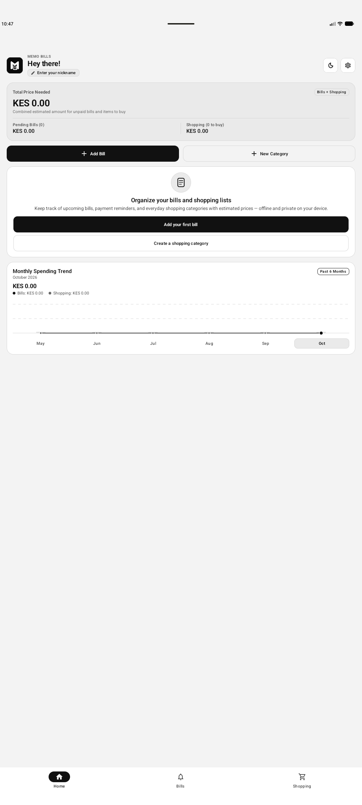
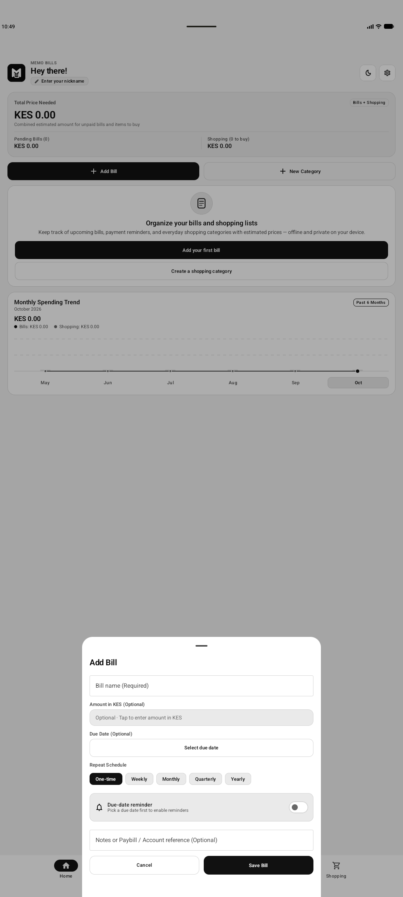

<div align="center">

# 📑 Memo Bills

**Privacy-First Offline Bills Tracker & Smart Shopping List Organizer for Android**

[](https://kotlinlang.org)
[](https://developer.android.com/jetpack/compose)
[](https://developer.android.com)
[](https://developer.android.com/training/data-storage/room)
[](https://github.com/oliver-kandagor/memobill)
[](LICENSE)

<br/>

<p align="center">
  <a href="#-features">Features</a> •
  <a href="#-screenshots">Screenshots</a> •
  <a href="#-architecture--tech-stack">Tech Stack</a> •
  <a href="#-getting-started">Getting Started</a> •
  <a href="#-project-structure">Project Structure</a> •
  <a href="#-contributing">Contributing</a> •
  <a href="#-license">License</a>
</p>

</div>

---

## 💡 About Memo Bills

**Memo Bills** is a lightweight, intuitive personal finance and household shopping organizer designed from the ground up to be **100% offline and privacy-respecting**. 

Unlike modern financial apps that demand bank logins, collect telemetry, or push subscription models, Memo Bills keeps **all your data strictly on your device**. No cloud syncs, no tracking, and no internet connection required.

Whether you're managing recurring monthly utility bills, planning rent deadlines, or tracking supermarket grocery estimates, Memo Bills provides a unified view of your upcoming commitments and spending trends.

---

## ✨ Features

- 📅 **Recurring Bills Management**
  - Track one-time, weekly, monthly, quarterly, or yearly commitments.
  - Smart due-date calculations and status flags (Pending, Paid, Upcoming).
  - Add account/paybill references and notes for frictionless payments.

- 🛒 **Categorized Shopping Lists**
  - Group shopping items by custom household categories.
  - Real-time estimated total calculations as you add or check off items.
  - Interactive checklists that keep your shopping trips organized.

- 📊 **Spending Trends & Analytics**
  - 6-month historical trajectory visualizing bills vs. shopping expenditure.
  - High-level metric summary cards showing total capital required at a glance.

- 🔒 **100% Offline & Private**
  - Local SQLite database backed by AndroidX Room.
  - Zero external analytics, zero trackers, zero network requirements.
  - Full data ownership stays on your physical phone.

- 🎨 **Modern Material 3 Design**
  - Clean, minimalist aesthetic with fluid animations.
  - Dark mode and light mode support with high contrast readability.
  - Custom currency keypad tailored for swift financial entry.

- ⏰ **Local Due-Date Reminders**
  - On-device notifications via Android AlarmManager/NotificationManager.
  - Never miss an important bill payment deadline.

---

## 📱 Screenshots

<div align="center">
  <table>
    <tr>
      <td align="center"><b>Dashboard & Analytics</b></td>
      <td align="center"><b>Add Bill & Quick Scheduling</b></td>
    </tr>
    <tr>
      <td></td>
      <td></td>
    </tr>
  </table>
</div>

---

## 🏗 Architecture & Tech Stack

Memo Bills follows **Modern Android Development (MAD)** best practices and clean MVVM architecture:

```
                      ┌──────────────────────────┐
                      │    UI Layer (Compose)    │
                      │   Screens & Components   │
                      └────────────┬─────────────┘
                                   │ StateFlow / Events
                      ┌────────────▼─────────────┐
                      │        ViewModels        │
                      │  (Home, Bills, Shopping) │
                      └────────────┬─────────────┘
                                   │ Coroutines
                      ┌────────────▼─────────────┐
                      │    Repository Layer      │
                      │   MemoBillsRepository    │
                      └────────────┬─────────────┘
                                   │ Flow / Room DAOs
                      ┌────────────▼─────────────┐
                      │  Local Database (Room)   │
                      │   SQLite On-Device DB    │
                      └──────────────────────────┘
```

- **Language:** [Kotlin](https://kotlinlang.org) 2.0+
- **UI Toolkit:** [Jetpack Compose](https://developer.android.com/jetpack/compose) with Material Design 3
- **Navigation:** [AndroidX Navigation Compose](https://developer.android.com/jetpack/compose/navigation)
- **Local Storage:** [AndroidX Room](https://developer.android.com/training/data-storage/room) with KSP (Kotlin Symbol Processing)
- **Asynchronous Execution:** Kotlin Coroutines & `StateFlow` reactive streams
- **Architecture:** Unidirectional Data Flow (UDF) + MVVM pattern
- **Build System:** Gradle 9.3.1 + Android Gradle Plugin 9.1.1 + Java 21

---

## 📂 Project Structure

```text
memobill/
├── app/
│   ├── src/main/
│   │   ├── AndroidManifest.xml
│   │   ├── java/com/example/
│   │   │   ├── MainActivity.kt               # App entrypoint & NavHost
│   │   │   ├── core/
│   │   │   │   ├── database/                 # Room Database, DAOs & Repository
│   │   │   │   ├── designsystem/             # Material 3 Theme, Typography, Keypad
│   │   │   │   ├── model/                    # Domain models & Money value types
│   │   │   │   ├── navigation/               # Route definitions & destinations
│   │   │   │   └── notifications/            # Local bill reminder scheduling
│   │   │   └── feature/
│   │   │       ├── home/                     # Overview, summary metrics & trend chart
│   │   │       ├── bills/                    # Bill creation, filters & list UI
│   │   │       ├── shopping/                 # Shopping categories & item checklists
│   │   │       └── settings/                 # Legal, info & preferences dialogs
│   │   └── res/                              # Drawables, mipmaps, XML rules & values
│   └── build.gradle.kts                      # Module-level Gradle build config
├── docs/
│   └── screenshots/                          # UI screenshots & preview assets
├── gradle/wrapper/                           # Gradle Wrapper (v9.3.1)
├── build.gradle.kts                          # Root project build configuration
├── settings.gradle.kts                       # Repository & plugin management
└── README.md                                 # Project documentation
```

---

## 🚀 Getting Started

### Prerequisites

- **JDK:** [Temurin OpenJDK 21](https://adoptium.net) or higher
- **Android Studio:** Ladybug (2024.2+) or newer
- **Android SDK:** Compile SDK 36 (Android 15+), Min SDK 24 (Android 7.0+)

### Building from Source

1. **Clone the repository:**
   ```bash
   git clone https://github.com/oliver-kandagor/memobill.git
   cd memobill
   ```

2. **Configure environment settings:**
   Copy the example environment configuration:
   ```bash
   cp .env.example .env
   ```

3. **Build the Debug APK:**
   ```bash
   ./gradlew assembleDebug
   ```
   The compiled APK will be located at:
   `app/build/outputs/apk/debug/app-debug.apk`

4. **Install onto connected device or running emulator:**
   ```bash
   ./gradlew installDebug
   ```

5. **Run Unit Tests:**
   ```bash
   ./gradlew test
   ```

---

## 🤝 Contributing

Contributions, feature requests, and bug reports are warmly welcome!

1. **Fork the Project**
2. **Create your Feature Branch:**
   ```bash
   git checkout -b feat/amazing-feature
   ```
3. **Commit your Changes:**
   ```bash
   git commit -m "feat(ui): add recurring bill calendar view"
   ```
4. **Push to the Branch:**
   ```bash
   git push origin feat/amazing-feature
   ```
5. **Open a Pull Request**

---

## 📄 License

This project is licensed under the **GNU General Public License v3.0** - see the [LICENSE](LICENSE) file for details.

---

<div align="center">
  Made with ❤️ by <a href="https://github.com/oliver-kandagor">Oliver Kandagor</a>
</div>
