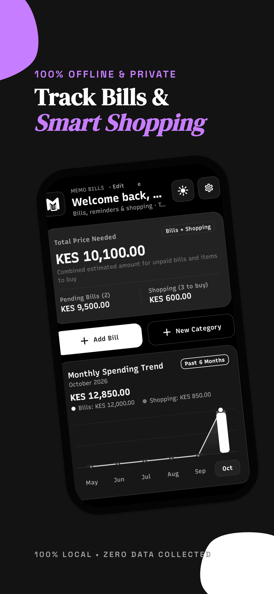
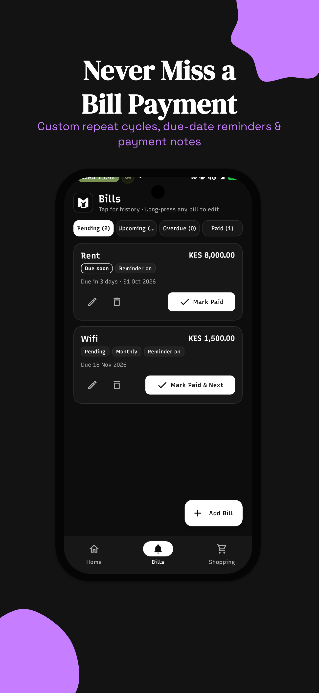
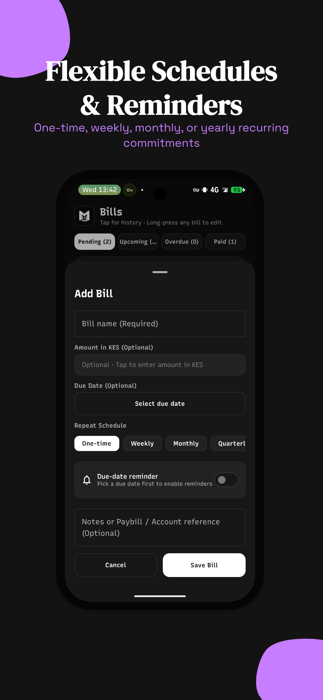
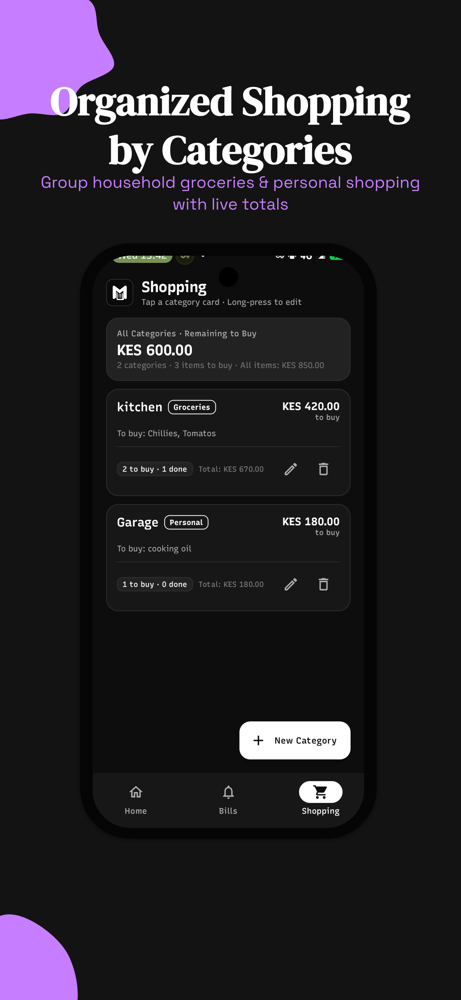
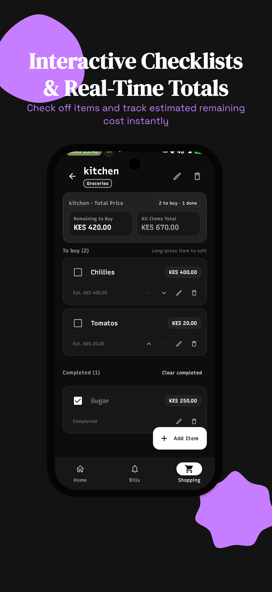
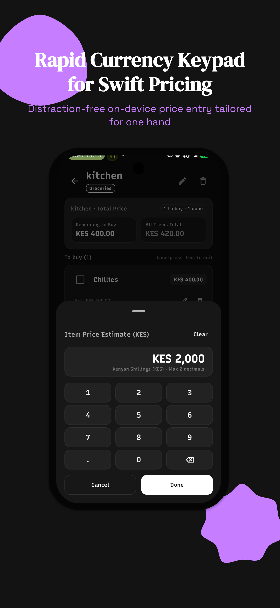

<div align="center">

# 📑 Memo Bills 🇰🇪

**Privacy-First Offline Bills Tracker & Smart Shopping Organizer Built for Kenya**

[](https://github.com/oliver-kandagor/memobill)
[-BB0000.svg?style=for-the-badge)](https://github.com/oliver-kandagor/memobill)
[](https://kotlinlang.org)
[](https://developer.android.com/jetpack/compose)
[](https://developer.android.com/training/data-storage/room)
[](https://github.com/oliver-kandagor/memobill)
[](LICENSE)

<br/>

<p align="center">
  <i>Panga bajeti yako bila stress. 100% Offline • Hakuna Ads • No Account Needed</i>
</p>

<p align="center">
  <a href="#-about-memo-bills">About</a> •
  <a href="#-tailored-for-the-kenyan-lifestyle">Kenyan Features</a> •
  <a href="#-features">Features</a> •
  <a href="#-screenshots">Screenshots</a> •
  <a href="#-architecture--tech-stack">Tech Stack</a> •
  <a href="#-getting-started">Getting Started</a> •
  <a href="#-license">License</a>
</p>

</div>

---

## 💡 About Memo Bills

**Memo Bills** is a lightweight, privacy-focused offline bills tracker and household shopping organizer designed for everyday life in Kenya. 

From scheduling monthly rent, electricity, and home internet to organizing your weekly supermarket or mama mboga grocery runs, Memo Bills gives you a unified, uncluttered view of your commitments in **KES (Kenyan Shillings)**.

Unlike cloud apps that require user accounts, collect tracking telemetry, or push subscriptions, Memo Bills keeps **100% of your data strictly on your physical device**. No cloud syncs, no tracking, and no internet bundles required.

---

## 🇰🇪 Tailored for the Kenyan Lifestyle

Memo Bills is designed around how Kenyan households plan and organize their everyday spending:

- 📅 **Track Everyday Kenyan Bills**  
  Effortlessly schedule and track recurring monthly or one-time household commitments:
  - 🏠 **Rent & House Service Charges**
  - ⚡ **Electricity Bills (Prepaid Tokens & Postpaid)**
  - 🌐 **Home WiFi (Safaricom Home Fibre, Zuku, Faiba, Airtel)**
  - 💧 **Water & Garbage Collection**
  - 🤝 **Chama & Social Group Contributions**

- 🛒 **From Supermarket Aisles to Mama Mboga**  
  Group items into custom categories (e.g., *Kitchen Groceries*, *Household Supplies*, *Personal*). Track price estimates for unga, cooking oil, tomatoes, and vegetables in real-time. As you check off items while shopping, watch your remaining expenditure update instantly.

- 📝 **Custom Notes & Reference Info**  
  Add optional reference notes to any bill (such as account numbers or reminders) so all your payment details stay organized in one private place.

- 💰 **Native KES Currency & Custom Keypad**  
  Built with native Kenyan Shilling (KES) formatting and a clean, dedicated calculator-style numeric keypad designed for rapid, one-handed amount entry.

- 📴 **100% Offline — Hakuna Bundles Needed**  
  Runs entirely on a local Room SQLite database. Works smoothly anywhere without data bundles, network connectivity, or external servers.

---

## ✨ Features

- 📅 **Recurring Bills Management**
  - Track one-time, weekly, monthly, quarterly, or yearly commitments.
  - Smart due-date calculations and status flags (Pending, Paid, Upcoming).
  - Add custom reference notes and payment details to keep your commitments organized.

- 🛒 **Categorized Shopping Lists**
  - Group shopping items by custom household categories.
  - Real-time estimated total calculations as you add or check off items.
  - Interactive checklists that keep your shopping trips organized.

- 📊 **Spending Trends & Analytics**
  - 6-month historical trajectory visualizing bills vs. shopping expenditure.
  - High-level metric summary cards showing total capital required at a glance.

- 🔒 **100% Offline & Private**
  - Local SQLite database backed by AndroidX Room.
  - Zero external analytics, zero trackers, zero network requirements.
  - Full data ownership stays on your physical phone.

- 🎨 **Modern Material 3 Design**
  - Clean, minimalist aesthetic with fluid animations.
  - Dark mode and light mode support with high contrast readability.
  - Custom currency keypad tailored for swift financial entry.

- ⏰ **Local Due-Date Reminders**
  - On-device notifications via Android AlarmManager/NotificationManager.
  - Never miss an important bill payment deadline.

---

## 📱 Screenshots

<div align="center">
  <table>
    <tr>
      <td align="center"><b>Dashboard & Analytics</b></td>
      <td align="center"><b>Bills Tracking</b></td>
      <td align="center"><b>Flexible Due Dates</b></td>
      <td align="center"><b>Shopping Categories</b></td>
      <td align="center"><b>Smart Checklists</b></td>
      <td align="center"><b>Fast Pricing Keypad</b></td>
    </tr>
    <tr>
      <td></td>
      <td></td>
      <td></td>
      <td></td>
      <td></td>
      <td></td>
    </tr>
  </table>
</div>

---

## 🏗 Architecture & Tech Stack

Memo Bills follows **Modern Android Development (MAD)** best practices and clean MVVM architecture:

```
                      ┌──────────────────────────┐
                      │    UI Layer (Compose)    │
                      │   Screens & Components   │
                      └────────────┬─────────────┘
                                   │ StateFlow / Events
                      ┌────────────▼─────────────┐
                      │        ViewModels        │
                      │  (Home, Bills, Shopping) │
                      └────────────┬─────────────┘
                                   │ Coroutines
                      ┌────────────▼─────────────┐
                      │    Repository Layer      │
                      │   MemoBillsRepository    │
                      └────────────┬─────────────┘
                                   │ Flow / Room DAOs
                      ┌────────────▼─────────────┐
                      │  Local Database (Room)   │
                      │   SQLite On-Device DB    │
                      └──────────────────────────┘
```

- **Language:** [Kotlin](https://kotlinlang.org) 2.0+
- **UI Toolkit:** [Jetpack Compose](https://developer.android.com/jetpack/compose) with Material Design 3
- **Navigation:** [AndroidX Navigation Compose](https://developer.android.com/jetpack/compose/navigation)
- **Local Storage:** [AndroidX Room](https://developer.android.com/training/data-storage/room) with KSP (Kotlin Symbol Processing)
- **Asynchronous Execution:** Kotlin Coroutines & `StateFlow` reactive streams
- **Architecture:** Unidirectional Data Flow (UDF) + MVVM pattern
- **Build System:** Gradle 9.3.1 + Android Gradle Plugin 9.1.1 + Java 21

---

## 📂 Project Structure

```text
memobill/
├── app/
│   ├── src/main/
│   │   ├── AndroidManifest.xml
│   │   ├── java/com/example/
│   │   │   ├── MainActivity.kt               # App entrypoint & NavHost
│   │   │   ├── core/
│   │   │   │   ├── database/                 # Room Database, DAOs & Repository
│   │   │   │   ├── designsystem/             # Material 3 Theme, Typography, Keypad
│   │   │   │   ├── model/                    # Domain models & Money value types
│   │   │   │   ├── navigation/               # Route definitions & destinations
│   │   │   │   └── notifications/            # Local bill reminder scheduling
│   │   │   └── feature/
│   │   │       ├── home/                     # Overview, summary metrics & trend chart
│   │   │       ├── bills/                    # Bill creation, filters & list UI
│   │   │       ├── shopping/                 # Shopping categories & item checklists
│   │   │       └── settings/                 # Legal, info & preferences dialogs
│   │   └── res/                              # Drawables, mipmaps, XML rules & values
│   └── build.gradle.kts                      # Module-level Gradle build config
├── docs/
│   └── screenshots/                          # UI screenshots & preview assets
├── gradle/wrapper/                           # Gradle Wrapper (v9.3.1)
├── build.gradle.kts                          # Root project build configuration
├── settings.gradle.kts                       # Repository & plugin management
└── README.md                                 # Project documentation
```

---

## 🚀 Getting Started

### Prerequisites

- **JDK:** [Temurin OpenJDK 21](https://adoptium.net) or higher
- **Android Studio:** Ladybug (2024.2+) or newer
- **Android SDK:** Compile SDK 36 (Android 15+), Min SDK 24 (Android 7.0+)

### Building from Source

1. **Clone the repository:**
   ```bash
   git clone https://github.com/oliver-kandagor/memobill.git
   cd memobill
   ```

2. **Configure environment settings:**
   Copy the example environment configuration:
   ```bash
   cp .env.example .env
   ```

3. **Build the Debug APK:**
   ```bash
   ./gradlew assembleDebug
   ```
   The compiled APK will be located at:
   `app/build/outputs/apk/debug/app-debug.apk`

4. **Install onto connected device or running emulator:**
   ```bash
   ./gradlew installDebug
   ```

5. **Run Unit Tests:**
   ```bash
   ./gradlew test
   ```

---

## 🤝 Contributing

Contributions, feature requests, and bug reports are warmly welcome!

1. **Fork the Project**
2. **Create your Feature Branch:**
   ```bash
   git checkout -b feat/amazing-feature
   ```
3. **Commit your Changes:**
   ```bash
   git commit -m "feat(ui): add recurring bill calendar view"
   ```
4. **Push to the Branch:**
   ```bash
   git push origin feat/amazing-feature
   ```
5. **Open a Pull Request**

---

## 📄 License

This project is licensed under the **GNU General Public License v3.0** - see the [LICENSE](LICENSE) file for details.

---

<div align="center">
  Made with ❤️ in Kenya 🇰🇪 by <a href="https://github.com/oliver-kandagor">Oliver Kandagor</a>
</div>
